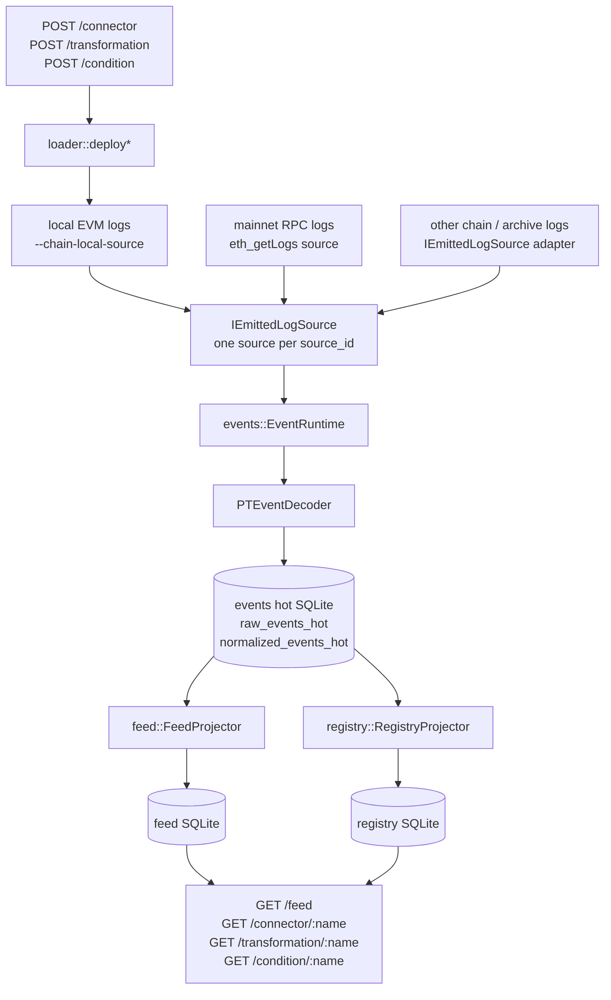
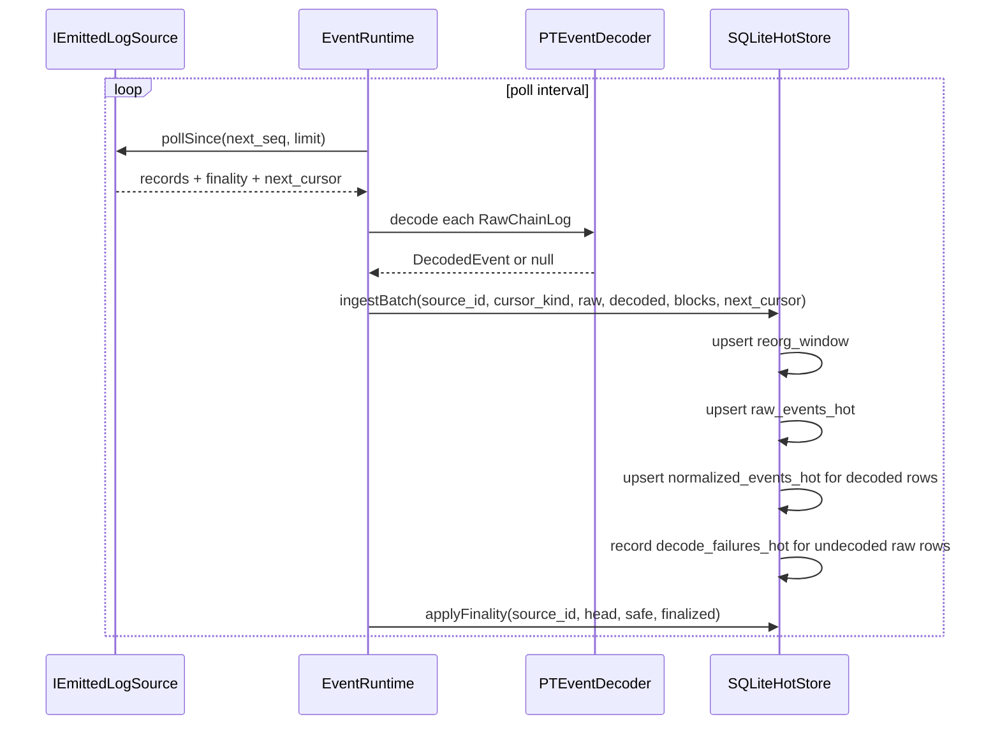
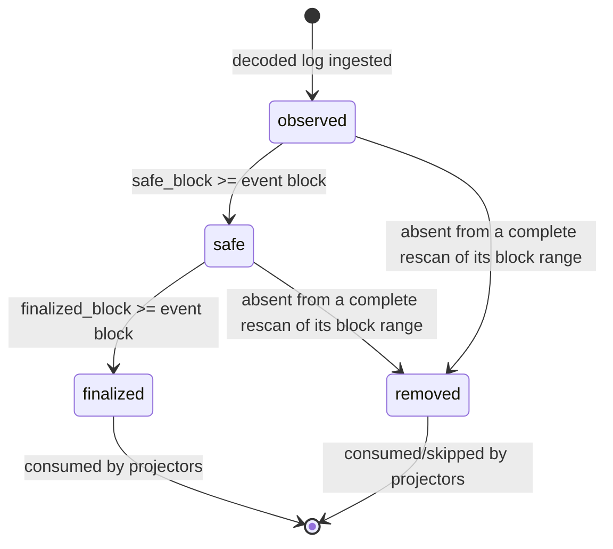
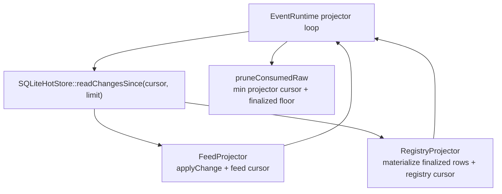
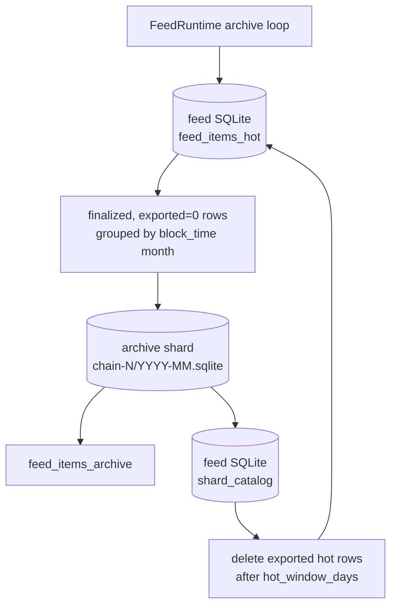
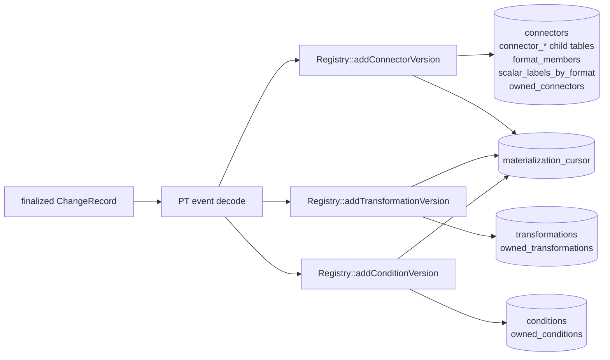

# Events Pipeline

The events module is the ingestion and projection layer for PT registry activity.
It turns PT registry logs (entity additions, removals and ownership changes) into
durable hot-store rows, then projectors materialize those rows into the feed and
registry databases.

## Runtime Wiring

`main.cpp` wires projectors before `EventRuntime::start()`. `FeedProjector` runs
first in each projector loop, then `RegistryProjector`. POST handlers deploy to
the EVM and return `201 Created` immediately: the chain-derivable response fields
come straight from the deploy — the connector `format_hash` is read back from the
emitted `ConnectorAdded` log, and `args_count` from the transformation/condition
record — so the response neither waits for nor depends on the registry projector
or ingestion being enabled. The projectors materialize the entity asynchronously,
so the `GET` read endpoints only reflect it once the event finalizes (and, with
ingestion disabled, never do). Each event source plugs in through
`IEmittedLogSource`: `LocalEvmSource` for `--chain-local-source`, `RpcLogSource`
for `--chain-rpc`. The runtime rejects duplicate sources for the same `source_id`
because the hot store keeps one cursor per source.

## Event Types

| PT event | Internal type | Decoder | Registry materialization |
| --- | --- | --- | --- |
| `ConnectorAdded(address,address,string,address,uint32,uint32[],string[],uint32[],uint32[],string[],string,int32[],bytes32,uint32[],uint32[],uint32[],uint32[],string[],uint32[],int32[],bytes32,bytes32,bytes32)` | `connector_added` | `pt::decodeConnectorAddedEvent` | `Registry::addConnectorVersion` with chain-emitted `format_hash` |
| `TransformationAdded(address,string,address,address,uint32,bytes32,bytes32,bytes32)` | `transformation_added` | `pt::decodeTransformationAddedEvent` | `Registry::addTransformationVersion` |
| `ConditionAdded(address,string,address,address,uint32,bytes32,bytes32,bytes32)` | `condition_added` | `pt::decodeConditionAddedEvent` | `Registry::addConditionVersion` |
| `{Connector,Transformation,Condition}Removed(address,address,string,address,bytes32,bytes32)` | `*_removed` | `PTEventDecoder` | `Registry::removeEntityVersion` |
| `EntityOwnerChanged(uint8,string,address,address,address)` | `entity_owner_changed` | `PTEventDecoder` | `Registry::changeEntityOwner` |

Every entity name is checked with `pt::isValidEntityName` while decoding: a name
this server cannot represent keeps its raw row but is never projected. Chain
strings are serialized with invalid UTF-8 replaced, so one hostile log cannot
stop ingestion.

Decoded fields are normalized into `DecodedEvent`: `name`, `caller`, `owner`,
`entity_address`, optional `args_count`, optional `format_hash`, and
`decoded_json`. The raw topics and data are kept because the registry projector
re-decodes finalized rows from canonical chain payloads.

## Ingestion Flow

| Step | Code owner | What happens |
| --- | --- | --- |
| Source polling | `IEmittedLogSource` | Pulls log records for one `source_id` and returns the cursor it scanned to, whether or not records were found, and the finality the poll proved (none when it proved nothing). `LocalEvmSource` adapts the in-process EVM and treats all seen blocks as finalized. `RpcLogSource` reads a remote chain over JSON-RPC. |
| Commit acknowledgement | `IEmittedLogSource::committed` | Called once the batch and cursor are durable. A source that advances internal state per poll applies it only then, so a failed commit re-delivers the same range. |
| Raw normalization | `EventRuntime::_runSourceIngestionLoop` | Converts `EmittedLogRecord` into `RawChainLog`, normalizes hex, collects `ChainBlockInfo`, and decodes PT events. |
| Local entity policy | `EventRuntime::_runSourceIngestionLoop` | For `LocalEvmSource`, decoded entity addresses are rewritten to `0x0`; this keeps local runtime addresses ephemeral. |
| Hot-store write | `SQLiteHotStore::ingestBatch` | One transaction updates block window data, raw rows, decoded normalized rows, decode failures, and the source cursor — including for an empty batch, so a source advances over empty ranges. |
| Range reconciliation | `SQLiteHotStore::ingestBatch` | When the poll reports a `scanned_range`, non-finalized rows inside it that the scan did not return are marked `removed` in the same transaction as the cursor commit. |
| Finality update | `SQLiteHotStore::applyFinality` | Advances `observed -> safe -> finalized` by block height and emits new `change_seq` values for normalized state changes. |

### RPC Log Source

`RpcLogSource` ingests a canonical PT registry from any standard Ethereum
JSON-RPC endpoint. It is enabled by `--chain-rpc` (or `--chain-rpc-env`, which
keeps a provider API key out of the process table) together with a deployment
manifest or `--chain-registry`, runs alongside `--chain-local-source`, and keeps
its own cursor:

- `source_id` is `eip155:<chain-id>:<registry-address>`. The provider URL is
  deliberately excluded, so switching providers resumes the same cursor instead
  of creating a second logical chain.
- `eth_getLogs` is filtered to the registry address and the known registry
  topic set, so ingestion cost tracks PT activity rather than chain activity. A
  returned log outside the filter is dropped and counted.
- Ranges the provider rejects as too large, or times out on, are halved down to
  a single block; successful ranges grow the width back cautiously.
- Polls form reconciliation cycles. Each cycle starts right after the finality
  already applied and scans forward to the head, one bounded range per poll, so
  the non-final tail is rescanned on every cycle and after every restart. Every
  poll reports the exact range it scanned, including empty ones: the cursor
  advances over empty history, and a reorg that leaves a replacement block with
  no PT event is still reconciled.
- Finality comes from the `safe` and `finalized` block tags, clamped to the head
  the poll read. Only a block scanned while the provider already considered it
  final, contiguous from the cycle start, becomes final: a block scanned earlier
  may still hold rows of a replaced fork until a later cycle rescans it. When the
  endpoint answers that it does not serve the tags, finality falls back to
  `head - --chain-confirmations` and the tags are tried again later; a transient
  failure only skips the poll.
- The hash of the last finalized block is persisted as an anchor. If the
  provider later reports another hash for it, the source pauses instead of
  rolling back finalized rows; it needs reindexing from a trusted provider.
- A proxy `Upgraded` event is never stored. It triggers a check of the new
  implementation's protocol identity and, with a manifest, its code hash; an
  implementation that does not match pauses the source instead of decoding with a
  guessed ABI.
- A rescan that returns a log again after a lagging node had it removed restores
  the row; nothing is duplicated.

At startup the configured deployment must identify itself: `eth_chainId` has to
match `--events-chain-id`, the registry address has to hold code, and
`protocolId()` / `protocolVersion()` have to match the protocol this build
supports. With `--chain-runner` the runner must report the same protocol and
link to the registry. Otherwise the server refuses to start.

The registry and runner addresses come from a deployment manifest
(`--deployment-manifest`) or from `--chain-registry` / `--chain-runner`; a
manifest also supplies the first block to scan and is verified down to the proxy
implementation slots, code hashes and upgrade owner. See
[../publish/README.md](../publish/README.md).

## Hot-Store Tables

| Table | Key | Purpose |
| --- | --- | --- |
| `raw_events_hot` | `(source_id, block_hash, log_index)` | Full raw log evidence: source, chain namespace, tx, block, topics, data, state, timestamps, and removal marker. |
| `normalized_events_hot` | `(source_id, block_hash, log_index)` | Decoded event index used by projectors: type, name, owner, entity address, args, format hash, content/metadata/runtime-code hashes, entity kind, previous owner, state, `change_seq`, and the per-projector `dead_letter` bitmask (see Failure Handling). |
| `decode_failures_hot` | `(source_id, block_hash, log_index)` | Tracks raw logs that could not decode; after repeated attempts rows become non-retryable/dead-lettered. |
| `source_resume` | `source_id` | The source's cursor: `cursor_kind` is `next_block` or `local_sequence`, `next_cursor` is the position to resume from. |
| `finality_state` | `source_id` | Current head, safe, and finalized heights for that source. |
| `reorg_window` | `(source_id, block_number)` | Rolling block hash window used to detect reorg replacements. |
| `change_seq_state` | singleton | Monotonic changelog sequence source for projector cursors. |

## State And Reorg Rules

| State | Meaning | Projector behavior |
| --- | --- | --- |
| `observed` | Log was ingested but is not safe/finalized. | Feed may expose it when requested; registry skips and advances its cursor. |
| `safe` | Log is at or below the safe height. | Feed can track the state; registry still skips. |
| `finalized` | Log is at or below the finalized height. | Feed persists final item; registry materializes the entity. |
| `removed` | Reorg replaced the original block/log before finalization. | Projectors consume or skip it; registry does not delete because finalized rows are outside the reorg window. |

`normalized_events_hot.change_seq` is updated on initial decode, reorg removal,
and finality promotion. This lets projectors see the same event again when its
state changes without scanning by block height.

## Projection Flow

| Projector | Cursor storage | Rows consumed | Result |
| --- | --- | --- | --- |
| `feed::FeedProjector` | Feed DB cursor | All changelog rows after its cursor | Applies feed deltas, persists feed cursor, maintains outbox. |
| `registry::RegistryProjector` | Registry DB `materialization_cursor` | All changelog rows after its cursor | Skips non-finalized rows; re-decodes finalized rows and writes registry tables. |

The prune loop deletes consumed finalized/removed raw and normalized rows only
when every projector has advanced beyond the row, the block is below the reorg
floor, and no dead-letter bit is set on the row. Projector cursors and the
dead-letter flag together form the data-retention safety net: raw evidence is
kept until every projector has either materialized the row or dead-lettered it,
and dead-lettered rows stay retained until they resolve (see Failure Handling).

## Feed Archive

Feed archive is owned by `FeedRuntime`, not by `EventRuntime`. Its loop calls
`Feed::runArchiveCycle(hot_window_days, now_ms)` every `archive_interval_ms`;
each cycle archives every chain the feed holds.

| Item | Behavior |
| --- | --- |
| Archive root | `--feed-archive-root`, default `storage/feed/archive`. |
| Shard path | `chain-<chain_id>/<YYYY-MM>.sqlite`, from `MonthlyEventShardRouter`. |
| Month source | `strftime('%Y-%m', block_time, 'unixepoch')` from finalized `feed_items_hot` rows. |
| Export predicate | `status='finalized'`, `exported=0`, `block_time IS NOT NULL`, and current projector version, for every chain; rows go to the shard of their own chain and month. |
| Archive table | Each shard stores `feed_items_archive`; only feed items are exported. |
| Catalog | Hot feed DB stores `shard_catalog(chain_id, archive_month, path, state, min_block, max_block, row_count, last_export_ms)`. Ready shards are marked `state='READY'`. |
| Hot pruning | Exported hot feed rows are deleted only after they are old enough for `hot_window_days`; archived copies remain in the monthly shard. |
| Events hot-store pruning | Separate from feed archive. Raw/normalized event rows are pruned by `EventRuntime` using projector cursors and the reorg floor. |

Historical feed reads merge the hot table with every READY shard of every chain:
the page order is by projection time, which neither a chain nor a block range
bounds. The registry database is not archived by month; it remains the current
materialized registry view.

## Registry Placement

| Entity | Primary table | Secondary tables | Notes |
| --- | --- | --- | --- |
| Connector | `connectors(name, owner, format_hash, condition_name)` | `connector_dimensions`, `connector_dimension_bindings`, `connector_transformation_defs`, `connector_transformation_def_args`, `connector_condition_args`, `connector_static_ri`, `format_members`, `scalar_labels_by_format`, `owned_connectors` | Stores only chain-derivable registry state. The format hash comes from the PT event. |
| Transformation | `transformations(name, owner, args_count)` | `owned_transformations` | Existing matching rows are idempotent; divergent rows are retried, then dead-lettered. |
| Condition | `conditions(name, owner, args_count)` | `owned_conditions` | Existing matching rows are idempotent; divergent rows are retried, then dead-lettered. |
| Cursor | `materialization_cursor(singleton, last_change_seq)` | none | Last hot-store `change_seq` durably consumed by `RegistryProjector`. |

## Failure Handling

Both projectors share one failure policy: retry in place, then quarantine — never
silently drop a chain event.

1. A row that fails (`FeedProjector` `applyChange` throws, or `RegistryProjector`
   `_materializeOne` returns false: undecodable log, divergence, add rejection)
   parks the cursor and is retried on each projector pass, so transient failures
   (e.g. a busy DB) heal on their own.
2. After `ProjectorRetryConfig::max_attempts` consecutive failing passes
   (`--events-projector-retry-attempts`, default 5) the projector sets its bit in
   `normalized_events_hot.dead_letter` (`FEED_DEAD_LETTER_BIT` /
   `REGISTRY_DEAD_LETTER_BIT`) and advances its cursor past the row, keeping the
   prune watermark moving for every other row. If the dead-letter mark itself
   cannot be written, the cursor stays parked.
3. Rows with any dead-letter bit set are exempt from `pruneConsumedRaw`: the raw
   and normalized chain evidence stays in the hot store until every marking
   projector resolves the row.
4. When a projector's changelog is drained, an idle-time sweep — throttled per
   projector by `ProjectorRetryConfig::sweep_interval_ms`
   (`--events-dead-letter-sweep-ms`, default 60 s) — re-reads its dead-lettered
   rows and retries them; on success the projector clears its bit and the row
   becomes prunable again. Divergence cases stay quarantined until the
   conflicting registry state is fixed, then resolve on the next sweep with no
   manual replay.

| Failure | Behavior |
| --- | --- |
| Unknown topic or undecodable source log during ingestion | Raw row is stored and `decode_failures_hot` is updated; no normalized row is projected. |
| Non-finalized registry row | Registry projector advances past it; finality promotion creates a later `change_seq` that will be seen. |
| Finalized registry row cannot be decoded | Retried for the configured budget, then dead-lettered: cursor advances, raw evidence is retained (exempt from pruning) and retried by the sweep. |
| Registry already has matching entity | Treated as idempotent success and cursor advances. |
| Registry has divergent entity | Retried for the configured budget, then dead-lettered; there is no update/delete reconciliation path, so it stays quarantined until the divergence is resolved, then the sweep clears it. |
| Feed row cannot be applied | Same policy with `FEED_DEAD_LETTER_BIT`: retried for the configured budget, dead-lettered, retried by the feed sweep. |
| Dead-lettered row reorg-removed before resolving | Registry sweep releases it (nothing left to materialize); pruning takes the row. |
| Projector cursor not advanced | Pruning cannot delete rows past the minimum projector cursor. |
