# Publish Module

On-chain publication of entities the server created locally, and bootstrap of a
private PT deployment. Owners send and pay for their own publication
transactions: the server prepares them and confirms them, and never holds a key
for them. The only key the server ever loads is the bootstrap deployer key, and
only while it deploys a registry and runner.

```mermaid
flowchart LR
    Prepare["POST /publish/&lt;kind&gt;/prepare"] --> Rebuild["loader::prepare*Publication<br/>rebuild from retained JSON"]
    Rebuild --> Check["Publisher::findPublished<br/>+ dependency identity check"]
    Check --> Upload["ArtifactStore::publish<br/>durable + read-back verified"]
    Upload --> Tx["unsigned registry call<br/>nonce, deadline, gas estimate"]
    Tx --> Wallet["owner's wallet<br/>eth_sendTransaction"]
    Wallet --> Confirm["POST /publish/&lt;kind&gt;<br/>tx_hash"]
    Confirm --> Receipt["receipt + registry event"]
```

## Components

| Piece | Responsibility |
| --- | --- |
| `Publisher` | `prepare`: checks connector dependencies against the target registry, binds the owner's publication nonce and a deadline, stores the artifact durably, estimates gas and returns the unsigned transaction. `confirm`: one receipt lookup, then validation of the registry event. `findPublished`: the registry's current answer for a name. |
| `DeploymentManifest` | The identity of one PT deployment: proxies, implementations, implementation code hashes, deployment block, protocol id/version, compiler and PT revision, upgrade owner. Written through a temporary file and renamed. |
| `verifyDeployment` | Re-proves a manifest against the live chain at startup: chain id, proxy implementation slots, implementation code hashes, protocol identity of registry and runner, the runner-to-registry link and the pinned upgrade owner. |
| `bootstrapDeployment` | Deploys registry and runner implementations and their proxies from one operator account, one transaction at a time, with gas and fee ceilings; waits for every receipt, verifies the result and returns the manifest. |
| `Signer` | Holds the bootstrap key while it is needed. Loaded from a file readable only by its owner, or from an environment variable that is cleared after reading. |
| `eth_tx` | Minimal RLP writer plus type-2 (EIP-1559) transaction encoding and signing hash. |

## Publication flow

1. `POST /publish/<kind>/prepare` with `{"name"}`, `kind` being `transformation`,
   `condition` or `connector`. The caller must own the entity. The server
   rebuilds it from the definition it retained when the entity was created (the
   registry mirrors chain state only and never holds Solidity source), so the
   published artifact is exactly what the server compiles.
2. When the registry already holds this exact publication the answer is
   `200 {"status": "published"}` and there is nothing to send. The same name with
   different content is `409`. For a connector, every transformation, condition,
   composite and binding it names must already be registered with the artifact
   the connector was built against; otherwise `409` lists `missing` and
   `mismatched` names. Dependencies are never published recursively.
3. The artifact bundle is written to every durable replica and read back
   verified before the transaction exists: an event whose artifact cannot be
   fetched is indexable but not reconstructable.
4. The answer is `200 {"status": "prepared", "transaction": {...}}` with `from`,
   `to`, `data`, `chainId` and `gas` ready for `eth_sendTransaction`, plus the
   deterministic entity `address`, the `content_hash`, the bound
   `publication_nonce` and the `deadline`. The calldata carries an empty owner
   signature: the registry accepts that because the owner is the sender. A
   deterministic revert (name taken, stale nonce, identity mismatch) is reported
   here, before the owner pays for it.
5. The owner's wallet sends the transaction.
6. `POST /publish/<kind>` with `{"name", "content_hash", "tx_hash"}` looks the
   receipt up once. `202 {"status": "pending"}` while it is unmined — repeating
   the request is the status check. `201 {"status": "mined"}` once the receipt
   has status 1 and carries exactly one matching typed event from the configured
   registry naming the entity, the owner and the content and metadata hashes.
   `400` when it reverted or registered something else.

The chain stays the source of truth: the registry projection of the event, not
the confirmation response, is what the server's read endpoints serve.

The web UI's Publish tab runs steps 1 to 6 with the browser wallet: it switches
the wallet to the transaction's chain, refuses to send from any account but the
owner, and keeps confirming while the transaction is pending.

## Identity bound into a publication

- The EIP-712 digest binds chain id and registry address (domain), kind, name,
  owner, content, metadata, creation-code and runtime-code hashes, the
  connector's registration hash, the owner's nonce and a deadline.
- For a connector, `registrationHash = keccak256(abi.encode(registration))`, so
  the arrays `ConnectorAdded` carries are the ones the owner authorized.
- The CREATE2 salt binds registry, kind, name, owner, content hash and nonce, so
  the entity address is known before the transaction is sent, and a cleared name
  can be published again with the same content.

## CLI

| Flag | Effect |
| --- | --- |
| `--publish` | Enables the `/publish/*` routes. Requires `--chain-rpc` (or `--chain-rpc-env`) and `--artifact-replicas`. Without it the routes answer `403`, so a client can tell a disabled server from a wrong URL. |
| `--deployment-manifest` | Manifest path (default `<storage>/deployment.json`). Supplies registry, runner and deployment block; an unreadable manifest stops startup. |
| `--publish-bootstrap` | Deploy registry and runner when no deployment is configured. For private and development chains: a canonical public deployment is an explicit release operation with a reviewed, committed manifest. |
| `--bootstrap-key-file` | File holding the deployer key in hex, readable only by its owner. Preferred form. |
| `--bootstrap-key-env` | Environment variable holding the deployer key (default `DCN_BOOTSTRAP_KEY`), used when no key file is given. |
| `--bootstrap-max-gas`, `--bootstrap-max-fee-gwei` | Ceilings the deployer signs under; an estimate or network fee above them fails the bootstrap instead of being clamped. |
