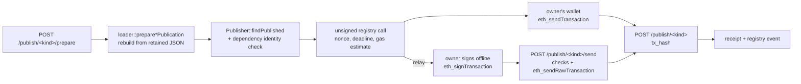

# Publish Module

On-chain publication of entities the server created locally, and deployment and
upgrade of the PT registry and runner. Owners send and pay for their own
publication transactions: the server prepares them and confirms them, and never
holds a key for them. The only key the server ever loads is the deployer key, and
only while it deploys or upgrades a registry or runner.

## Components

| Piece | Responsibility |
| --- | --- |
| `Publisher` | `prepare`: checks connector dependencies against the target registry, binds the owner's publication nonce and a deadline, estimates gas and returns the unsigned transaction; for a relay, also the owner's account nonce and fees. `send`: checks an offline-signed transaction and broadcasts it. `confirm`: one receipt lookup, then validation of the registry event. `findPublished`: the registry's current answer for a name. |
| `DeploymentManifest` | The identity of one PT deployment: proxies, implementations, implementation code hashes, deployment block, protocol id/version, compiler and PT revision, upgrade owner. Written through a temporary file and renamed. |
| `verifyDeployment` | Re-proves a manifest against the live chain at startup: chain id, proxy implementation slots, implementation code hashes, protocol identity and the pinned upgrade owner of the registry, and of the runner when the manifest has one. `verifyContract` does the same for one of them. |
| `deployContract` | Deploys a registry or runner implementation and a proxy that initializes it, from one operator account, one transaction at a time, with gas and fee ceilings; waits for every receipt, verifies the result and returns the manifest with that contract replaced. The other contract is kept and must verify first; the previous proxy stays on chain unused. Deploying a registry also sets the deployment block. |
| `upgradeContract` | Verifies the live deployment against the manifest, deploys a registry or runner implementation and calls `upgradeToAndCall` on its manifest proxy, then verifies again and returns the manifest pinning the new implementation. The proxy address is unchanged; the new implementation must keep the contract's storage layout. |
| `Signer` | Holds the deployer key while it is needed. Loaded from a file readable only by its owner, or from an environment variable that is cleared after reading. |
| `eth_tx` | Minimal RLP writer plus type-2 (EIP-1559) transaction encoding, signing hash, and decoding of a signed transaction with sender recovery. |

## Publication flow

1. `POST /publish/<kind>/prepare` with `{"name"}`, `kind` being `transformation`,
   `condition` or `connector`. The caller must own the entity. The server
   rebuilds it from the definition it retained when the entity was created (the
   registry mirrors chain state only and never holds Solidity source). The
   publication's content hash is the keccak256 of the canonical bundle
   describing that build; the bundle itself is not stored or served.
2. When the registry already holds this exact publication the answer is
   `200 {"status": "published"}` and there is nothing to send. The same name with
   different content is `409`. For a connector, every transformation, condition,
   composite and binding it names must already be registered with the content
   hash the connector was built against; otherwise `409` lists `missing` and
   `mismatched` names. Dependencies are never published recursively.
3. The answer is `200 {"status": "prepared", "transaction": {...}}` with `from`,
   `to`, `data`, `chainId` and `gas` ready for `eth_sendTransaction`, plus the
   deterministic entity `address`, the `content_hash`, the bound
   `publication_nonce` and the `deadline`. The calldata carries an empty owner
   signature: the registry accepts that because the owner is the sender. A
   deterministic revert (name taken, stale nonce, identity mismatch) is reported
   here, before the owner pays for it.
4. The owner's wallet sends the transaction.
5. `POST /publish/<kind>` with `{"name", "content_hash", "tx_hash"}` looks the
   receipt up once. `202 {"status": "pending"}` while it is unmined — repeating
   the request is the status check. `201 {"status": "mined"}` once the receipt
   has status 1 and carries exactly one matching typed event from the configured
   registry naming the entity, the owner and the content and metadata hashes.
   `400` when it reverted or registered something else.

The chain stays the source of truth: the registry projection of the event, not
the confirmation response, is what the server's read endpoints serve.

## Relayed publication

An owner without their own chain endpoint signs the transaction and lets the
server broadcast it. The owner still pays for it from their own account; the
server only forwards what the owner signed and never holds a key for it.

1. `POST /publish/<kind>/prepare` with `{"name", "relay": true}`. The answer also
   carries `signing`: `type` `0x2`, the owner's pending account `nonce`,
   `maxFeePerGas`, `maxPriorityFeePerGas` and `value` `0x0`, all hex quantities.
   `relay` is opt-in, so a browser wallet keeps choosing its own nonce and fees.
2. The owner signs `transaction` merged with `signing` offline, for example with
   `eth_signTransaction` or a local key.
3. `POST /publish/<kind>/send` with `{"name", "content_hash", "raw_tx"}`. Before
   broadcasting, the server checks the following and stops at the first failure:
   - the transaction decodes as a canonical type-2 transaction with no access list
     and a low-`s` signature (`400`);
   - the caller signed it (`403`);
   - it is for the deployment's chain, calls the registry and transfers no value
     (`400`);
   - its calldata publishes exactly the named entity with the requested content
     hash (`400`);
   - a dry run succeeds (`400` on revert) within the transaction's gas limit (`400`).
4. The answer is `202 {"status": "pending", "tx_hash"}` once the provider accepts
   the transaction, or already holds it: a retried request is harmless. A used
   account nonce, or another pending transaction with the same nonce, is `409`,
   so prepare again.
5. `POST /publish/<kind>` confirms it as in the publication flow above.

The web UI's Publish tab offers this as "Relay through the server" for wallets
that can sign without sending. MetaMask cannot, so it is off by default.

The web UI's Publish tab runs steps 1 to 6 with the browser wallet: it switches
the wallet to the transaction's chain, refuses to send from any account but the
owner, and keeps confirming while the transaction is pending.

## Identity bound into a publication

- The EIP-712 digest binds chain id and registry address (domain), kind, name,
  owner, content, metadata, creation-code and runtime-code hashes, the
  connector's registration hash, the owner's nonce and a deadline.
- For a connector, `registrationHash = keccak256(abi.encode(registration))`, so
  the arrays `ConnectorAdded` carries are the ones the owner authorized.
- The CREATE2 salt binds registry, kind, name, owner, content hash and nonce, so
  the entity address is known before the transaction is sent, and a cleared name
  can be published again with the same content.

## CLI

| Flag | Effect |
| --- | --- |
| `--publish` | Enables the `/publish/*` routes. Requires `--chain-rpc` (or `--chain-rpc-env`). Without it the routes answer `403`, so a client can tell a disabled server from a wrong URL. |
| `--deployment-manifest` | Manifest path (default `<storage>/deployment.json`). Supplies registry, runner and deployment block; an unreadable manifest stops startup. |
| `--publish-deploy-registry` | Deploy a new registry with the deployer key and rewrite the manifest, creating it when there is none. A manifest runner is kept. |
| `--publish-deploy-runner` | Deploy a new runner with the deployer key and rewrite the manifest. Requires a manifest registry. |
| `--publish-deploy` | Both of the above: a complete new deployment. For private and development chains: a canonical public deployment is an explicit release operation with a reviewed, committed manifest. |
| `--publish-upgrade-registry` | Upgrade the manifest registry proxy to a newly deployed implementation with the deployer key and rewrite the manifest. |
| `--publish-upgrade-runner` | The same for the manifest runner proxy. |
| `--publish-upgrade` | Both of the above. |
| `--deployer-key-file` | File holding the deployer key in hex, readable only by its owner. Preferred form. |
| `--deployer-key-env` | Environment variable holding the deployer key (default `DCN_DEPLOYER_KEY`), used when no key file is given. |
| `--deployer-max-gas`, `--deployer-max-fee-gwei` | Ceilings the deployer signs under; an estimate or network fee above them fails the action instead of being clamped. |

Deployment actions run at every startup that passes them, registry before runner,
then the server starts on the deployment the manifest now describes. The manifest
is rewritten after each action, so a later failure never loses a contract that
already exists on chain. Deploying and upgrading the same contract in one run is
rejected. Whenever the manifest already has a contract, the deployer key must be
its owner: both proxies share one upgrade owner.

The runner holds no registry: `Runner.gen(registry, name, particlesCount,
dynamicRi)` looks the root connector up in the registry it is given, and every
connector resolves its dependencies in its own registry. A registry and a runner
are therefore deployed and upgraded independently.
